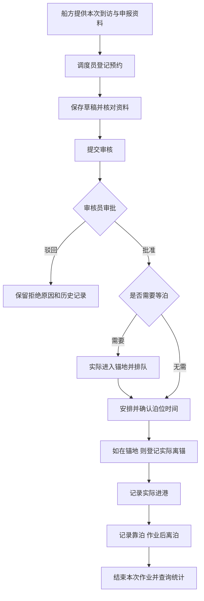

# PortQueue 业务流程与模块职责

更新：2026-11-10。本文件是中期口径说明，替代此前混合已实现、已建库与待开发功能的表述。

## 系统到底服务谁

PortQueue 是单港口的内部业务工作台，本次主港为上海洋山深水港。核心任务是把船方的进港申请、等泊、泊位安排和实际作业串起来，并留下可查询的记录。

原《选题与系统功能说明》明确：主要使用者是“港口调度员、预约审核人员和作业记录人员”；“调度员依据船公司提供的船舶和本港到访信息登记预约”。因此必须区分两个身份：

- **申请提出者：** 船公司或其授权代理、船方负责人，提供船舶、预计到访、货物和进港申请资料。
- **系统录入者：** 港口调度员，在本系统代为录入和提交，对自己的操作负责。

船员不是天然拥有所有船舶申报权限的统一角色；若以后开发船方自助端，应先明确船公司/代理与账户的归属、能操作哪些船舶、只能查看哪些申请，再评审模型和授权。中期没有船方门户，不把调度员改名为船员来冒充已经实现。

## 一条业务主线

中期页面完整支持 B 至 E。F 的驳回记录可查询，但重新申请与复用申报资料的专门操作未设计为本批功能；原驳回记录不能直接改成草稿。G 之后的业务已有数据库对象和场景，专用页面及业务 API 中期后再接入。无须等泊的船不建立虚假的锚地记录。

## 每个模块做什么

| 模块 | 回答的问题 | 主要输入 → 处理 → 输出 | 中期状态 |
|---|---|---|---|
| 总览 | 系统内目前有多少待处理预约，港口整体情况如何 | 数据库查询 → 状态统计、在场数与动态 → 图文概况和预约入口 | 已开放；概要不等于后续模块已开放 |
| 进港预约 | 船方申请什么、审核是否通过 | 船舶、到访、申请时间、货物及吃水 → 登记、编辑草稿、提交、审核 → 状态、责任人、时间与意见 | 已开放；撤销及驳回后重申尚未接入 |
| 锚地排队 | 哪些船已进入锚地、应按什么次序安排 | 已批准预约、锚地、实际进出时间 → 入锚、排队、调序、离锚 → 当前队列与调整记录 | 待接入 |
| 泊位计划 | 安排哪个泊位、哪个时间窗 | 已批准预约、泊位条件、预计作业时间 → 适配与冲突检查、编制、确认、调整 → 当前计划及历史版本 | 待接入 |
| 进出港记录 | 实际发生了什么、发生在什么时候 | 预约/排队/适用计划、真实作业时间 → 受控登记 → 实际记录与责任人 | 待接入；总览近期动态仅查询已有记录 |
| 查询统计 | 等了多久、计划与实际差多少 | 申请、计划及实际事实 → 按一致口径计算 → 等待、偏差等报表 | 待接入 |
| 基础资料与账号 | 业务引用什么船、港口、设施和角色 | 已维护资料 → 校验引用和权限 → 候选、登录身份与授权 | 已有数据库资料、候选和登录；维护页面待接入 |

前三个后续模块的通用列表已撤下，专用 `/api/business/queue`、`plans`、`events` 也不再开放。侧栏标记待接入；总览主图保留入口布局，点击未开放模块只显示未接入提示。数据库视图可以在 SQL Server 中展示，这不代表相应业务模块已经开发完成。

## 容易混淆的几个词

| 词语 | 一句话解释 | 例子 |
|---|---|---|
| 船舶 | 长期存在的一艘船 | 海岚远航的 IMO、船型、尺寸 |
| 本港到访 | 这艘船这一次来本港的行程 | 同一艘船本月第二次到访，有独立到访记录 |
| 进港预约 | 针对这次到访提出的进港申请 | 希望何时到离港、货物、吃水、作业时长 |
| 锚地排队 | 实际进入锚地之后的等候安排 | 在哪处锚地、第几位、为何调序 |
| 泊位计划 | 港方安排的泊位和作业时间 | 01号泊位，某日10:00至20:00 |
| 计划版本 | 同一计划每次修改后的历史安排 | 从10:00调整为12:00，保留原安排及确认人 |
| 作业记录（底层称事件） | 已经发生的一个事实 | 09:20进入锚地，12:15靠泊 |
| 审计日志 | 谁修改了哪份数据、修改前后是什么 | 调度员改了箱量，审核员批准了预约 |

“事件”是数据库归纳入锚、离锚、进港、靠泊、离泊的存储名称，用户界面使用相应业务动作。审计记录的是数据操作，实际事件记录的是船舶作业，两者不能混用。当前事件模型包含入锚、离锚、进港、靠泊、离泊，未单独建模港界离港事实；因此离泊完成不能表述为已记录船舶驶离港界。后续实际作业模块设计时再明确该边界。

## 时间分别表示什么

| 时间 | 谁提供/形成 | 保存位置 | 能否互相替代 |
|---|---|---|---|
| 本次到访预计到离港 | 船方给出的行程预计 | port_call 的 planned_arrival_at / planned_departure_at | 是行程背景，不等于港方承诺 |
| 申请到离港 | 船方在预约中提出的时间诉求 | arrival_appointment | 可与行程预计相同，也可因申报调整而不同 |
| 计划靠离泊 | 港方确认的泊位资源安排 | berth_plan_revision | 不能在登记预约时当作已经分配的泊位 |
| 实际进锚/进港/靠离泊 | 现场事实或后续可信接口 | port_event 及分类关联 | 不能用预计或申请时间推算 |

为减少误读，登记表单使用“本次到访预计时间”“预计到港/离港”，并保留“申请到港/离港”；沿用申请时间是一次明确复制操作。数据库字段和正式关系模型没有因此变更。所有业务时间显示为北京时间，数据库内部使用 UTC。

## 状态、角色与权限

草稿表示未提交，待审核表示已提交，已批准表示审核允许继续安排作业，已驳回表示审核拒绝，已撤销表示申请终止，已完成表示本模型内的靠离泊作业已经结束。状态由数据库保存，不能依据时间或图标猜测。**已批准不等于已经进港，更不等于已经靠泊。**

| 角色 | 中期实际权限 | 后续职责 |
|---|---|---|
| 调度员 DISPATCHER | 查询，依据船方资料登记、编辑草稿、提交 | 队列调整、泊位计划编排与确认 |
| 审核员 REVIEWER | 查询，批准/驳回待审核预约 | 继续承担预约审核 |
| 记录员 RECORDER | 当前只读 | 登记实际作业时间与记录 |
| 管理员 ADMIN | 可登记、提交和审核，维护本机账号 | 基础资料与账号管理 |

演示时使用“调度员提交 → 审核员审核”两种账号，便于清楚表达职责。当前正式模型每个账号对应一个角色；管理员可跨职责操作。录入人及审核人来自会话，不能由页面传入任意用户标识。外部船方账户、组织隔离和禁止本人审核自己的申请不属于本次已实现规则，不用演示话术暗示具备。

## 总览与数据口径

待审核为全部 PENDING 预约；锚地在场为已有入锚而尚未离锚的停留记录；待靠泊为已确认但尚未开始执行的计划；预约分布覆盖全部六种状态。它们描述不同事实，不能相加称为船舶总数。港口动态读取实际事件时间，不把它称为 AIS 实时船位。“进港流程”用居中节点和沿线小船表达业务关系，小船是方向动效，不绑定真实船舶或实时位置。可暂停，屏外、后台、离页和减少动画时停止。总览每30秒读取当前数据库快照，本页写入后立即刷新；它不是外部实时AIS推送。

主港为上海洋山深水港，SH-YS 是项目内部代码。库内3座码头、4处锚地、3个泊位是课程场景登记量，不代表现实港口完整规模。旧青岛港保留为前后港可引用的外部资料；已知合成设施迁入新主港，未改写预约、航次前后港或事件。旧锚地坐标清空，待获得可靠地理资料后再维护。

开发库已有合成场景，用户可以继续登记和审核，数量应随真实数据库操作变化；不能把某次截图里的54条写死为系统总量。中期图像是有来源记录的全局场景装饰，不是上海洋山现场认证照片或某条预约的实船照片。

## 中期答辩展示顺序

1. 总览说明服务范围、状态和两条作业路径，指出待接入模块。
2. 调度员依据船方提供的示例资料登记，保存草稿并修改。
3. 提交后切换审核员，批准或填写原因驳回。
4. 刷新/重开页面验证结果持久化，查看状态、审核人及时间。
5. 在 SQL Server 展示表结构、主外键、视图和存储过程；查询本次预约及审计，解释事务、权限和并发保护。
6. 说明后续锚地、泊位及实际作业的设计计划，不把数据库对象演示说成这些页面已经完成。

中期之后先详细设计锚地入场与排队业务，再进入开发；当前版本以范围稳定、业务解释清楚、登记审核可复现为冻结目标。

## 页面是否能增加数据

预约已经可以从页面新增：登录调度员或管理员 → 进港预约 → 清单右上角“登记预约” → 选择已有船舶、填写申请 → 保存草稿或提交审核。草稿可修改，提交后由审核员批准/驳回；保存到 SQL Server，重开浏览器仍存在。未登录、审核员和记录员没有登记按钮，是权限边界，不是数据固定。

船舶、船公司、码头、锚地和泊位属于基础资料，中期没有维护页面，仍由受控 SQL 资料脚本管理。新增一条预约是让已登记船舶提出一次新的到访申请，不等于新增一艘船。锚地进入、计划确认及实际作业的页面待接入，因此当前锚地在场与待靠泊主要反映已经装载的业务场景；不会因时间经过或新建预约而自动变化。

三个指标分别表示申请待办、锚地实际占用、下一步已确认安排，没有限定为今日。它们的单位分别为预约记录、锚地停留记录和当前计划，可能涉及同一艘船，不可相加为总船数。在场统计包含已经分配泊位但尚未离锚的记录，因此不等于只统计 WAITING 队列。
