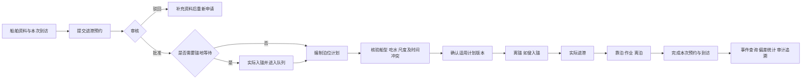

# PortQueue 业务流程与界面职责

更新：2026-11-08。本文解释现有模型、已实现能力和后续业务入口，不把已建表或已有存储过程等同于页面功能完成。

## 业务核心

系统围绕一次船舶到港作业协调四类事实：船方申请什么时间到离港；船舶实际在哪里等待；港口为它安排哪个泊位、哪个时间窗；最终发生了哪些实际事件。预约是入口，排队和计划是协同，事件与审计是核对依据。

同一艘船可以多次到访，每次到访有自己的 `port_call`；当前模型一次到访最多关联一份预约。船舶基础资料、预约、锚地停留、计划版本和实际事件各自保存不同事实，不应在每张表复制一套相同的时间和状态。

直接靠泊路径没有锚地停留记录；图中的“离锚”只对曾进入锚地的船舶适用。不能为了让流程图整齐而强制每艘船都走锚地。

## 页面分工

| 页面 | 面向的问题 | 当前情况 |
|---|---|---|
| 总览 | 当前有多少待审核、锚地在场、待靠泊计划；最近发生了什么 | 已接入独立只读总览 API，并显示预约摘要与近期事件 |
| 进港预约 | 查哪一份申请，申请了什么时间，审核结果是什么 | 查询、状态筛选、分页、详情已完成；登记、提交、审核和撤销页面待开发 |
| 锚地排队 | 哪些船实际在锚地，等待顺序和原因是什么 | 数据库过程与视图已具备，页面/API 待接入 |
| 泊位计划 | 哪个泊位的哪个时间窗可用，调整前后有什么变化 | 版本与确认过程已具备，页面/API 待接入 |
| 进出港记录 | 哪艘船何时入锚、离锚、进港、靠泊、离泊 | 事件模型与过程已具备，总览读取近期事件，完整记录/录入页待接入 |
| 查询统计 | 等待时长、计划偏差等怎样计算 | 数据库统计查询已具备，报表/API 待接入 |

“实际执行”是内部流程概括，菜单改为“进出港记录”以表达具体任务。当前事件代码为入锚、离锚、进港、靠泊、离泊五类；现有模型没有独立 `PORT_LEAVE` 出港事件，不得将离泊时间描述成已经验证的港界离港时间。是否增加独立出港事实，需后续同步评审正式模型。

## 三套时间不能混用

| 时间 | 保存位置 | 含义 |
|---|---|---|
| 申请到港 / 申请离港 | arrival_appointment | 船方希望到离港的时间，是预约诉求 |
| 计划靠泊 / 计划离泊 | berth_plan_revision | 港口确认的泊位资源安排，每次变更保留版本 |
| 实际入锚 / 进港 / 靠泊 / 离泊等 | port_event 及分类关联 | 已经发生的事实，由实际登记或未来接口提供 |

实际靠泊可以晚于计划，不能反过来修改申请时间或历史计划来“消除偏差”。偏差使用执行前最后确认的适用版本；已执行记录绑定该版本，后来调整不能重写过去。

原五条预约的申请时间全部相同，是早期用于验证流程的固定样例，并非排序、显示或时区错误。本轮新增 48 条预约形成不同日期、时刻与作业时长，数据库合计 53 条、49 个不同申请到港时刻。原五条时间因已有历史事件而保留，避免随意篡改历史。

## 预约状态从哪里来

状态是 `arrival_appointment.appointment_status_code` 中的持久化值，数据库 CHECK 约束限定六类；API 原样返回业务代码，前端只负责中文名称和颜色。

| 状态 | 业务含义 | 触发者/规则 |
|---|---|---|
| 草稿 DRAFT | 申请尚未提交 | 后续登记/保存草稿操作；当前只读页不执行 |
| 待审核 PENDING | 已提交，等待审核决定 | 后续提交操作；不能根据时间自动猜测 |
| 已批准 APPROVED | 审核通过，可安排等待和计划 | `usp_review_appointment` 只接受待审核记录，写审核人、时间、意见与审计 |
| 已驳回 REJECTED | 资料或条件不满足 | 同一审核过程，驳回必须填写原因 |
| 已撤销 CANCELLED | 申请主动终止 | 后续撤销事务；涉及队列、计划时需统一处理，不是删记录 |
| 已完成 COMPLETED | 本模型内的靠离泊作业闭环已结束 | 现有离泊过程完成事件记录后同步完成计划、预约与到访 |

已批准不等于已经进港、已经靠泊或已经完成。批准后的船可以尚未到达、正在锚地等待或已执行作业；这些由队列、计划和事件的各自状态区分。已驳回的审核记录说明审核已完成，但结果是拒绝，界面不能以绿色通过标识混淆。

本轮场景是带来源说明的历史/预设数据导入：保留明确的历史审核、确认时间；实际事件通过既有过程生成；正常业务写入仍应走受控事务。不能把合成场景的初始化脚本当成日常任意改状态工具。

## 总览口径

- 待审核预约：所有 PENDING 预约数量，不随预约页关键词、页码或状态筛选变化。
- 锚地在场：已有实际入锚事件、没有实际离锚事件的停留数。它不等于“有效队列长度”；撤销预约后仍未离锚的船依然占用锚地。
- 待靠泊计划：状态为 CONFIRMED 的当前计划；已经靠泊进入 EXECUTING 的计划不再计入。
- 港口动态：按事件时间、事件主键倒序取最新五条，不把预约申请时间冒充实际事件。

各指标分别回答一个问题，不能直接相加作为“港口船舶总量”。总览通过单条 SELECT 和已有 RCSI 读取一致语句快照，失败时显示空缺和重试。

## 数据与图片

当前 53 条为可复现合成场景：草稿 8、待审核 9、已批准 10、已驳回 8、已撤销 8、已完成 10；包含锚地在场 10 艘、已确认待靠泊计划 4 项。船名、人员及标识均非真实港口数据认证，IMO 使用七位及校验位形式并不代表已核实的注册船舶。

`12_refresh_sample_labels.sql` 整理原样例名称，保留主外键和历史事实并追加快照；`13_seed_port_scenarios.sql` 增加 48 条场景，同一事务失败全部回滚，重跑不重置状态。不应通过前端替换名称或伪造数量来改善展示。

主图使用用户新提供的较清晰图片，作为港口场景装饰；它不根据预约 ID 读取，不能理解为对应船舶的实船照片。原小图仍用于装饰缩略图。来源保存在素材旁文件与嵌入元数据，界面不重复添加“示意”“课程”等次要标签。

## 账号与权限的下一批实现

左下应显示已经登录的姓名和角色，并提供账号操作。当前没有真实认证会话，因此仅显示“未登录”，不假扮管理员，也不提供无效下拉。

沿用现有四类角色，不为菜单再增关系：

| 角色 | 计划授权职责 |
|---|---|
| 管理员 ADMIN | 账号/角色分配及基础资料维护；业务特权需明确策略 |
| 审核员 REVIEWER | 预约查询、审核批准/驳回 |
| 调度员 DISPATCHER | 预约查询、登记/草稿编辑/提交、排队调整、计划编制/确认 |
| 记录员 RECORDER | 查询与实际事件登记 |

同一人是否兼任多角色需按正式模型处理，目前 `user_account.role_code` 是单角色设计。现有过程只校验操作者和角色启用，尚未逐类授权；数据库最小权限角色 `portqueue_app` 限制直写表，不等同于业务角色权限完成。

第三阶段设计见 [身份权限与预约业务计划](stages/stage-3-appointment-workflow.md)，本轮仅完成规划。3A 采用 ASP.NET Core Cookie、标准密码哈希、HttpOnly Cookie、写请求防伪造；由会话决定 operator_id，不信任前端传入身份。姓名/角色来自 `/api/session`；后端决定权限，前端据此展示。管理员在本阶段明确拥有登记/提交与审核权限；调度员负责登记/提交，审核员负责批准/驳回，记录员只读。3B 接审核，3C 接登记/草稿编辑/提交。

验收至少覆盖：未登录访问受保护 API 为 401、已登录但无权限为 403、正确角色执行成功、伪造 operator_id 无效、停用账号失效、退出后不可继续操作、无明文密码/令牌提交、越权失败无业务残留。下一步仍按单一功能批次推进，不在视觉调整中假装已经完成认证。
