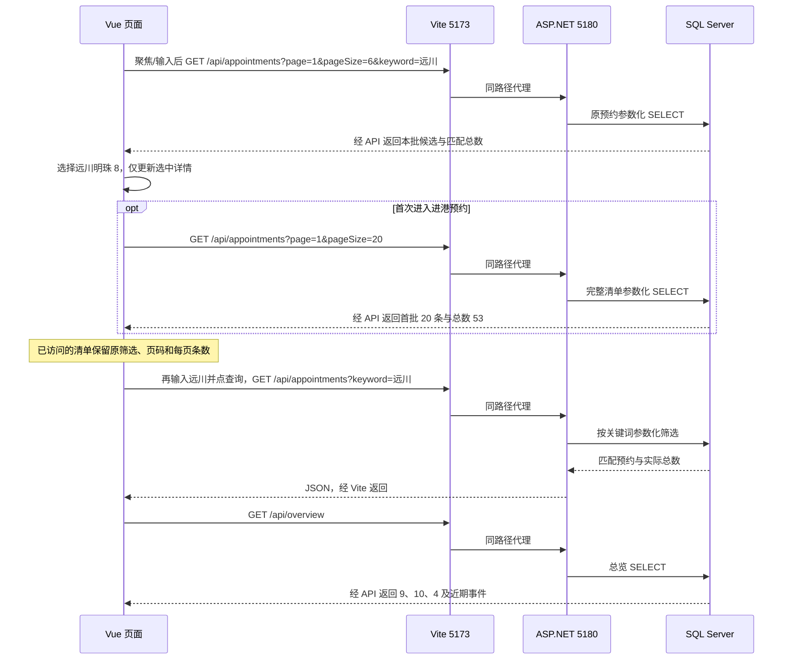

# 阶段 2 交付说明：真实查询与港口总览

更新：2026-11-09。本文件描述当前可运行成果；历史测试与交付记录保留在 `docs/reviews/`。最新一批验收计划见 `stage-2-search-and-events.md`，此前交互计划见 `stage-2-interaction-polish.md`，业务解释见 `../business-flow.md`。

## 1. 本轮的目标与变化

最新一批补齐候选总数、逐批加载与完整结果入口；港口动态标题固定，正文自动滚动并可暂停、翻页和打开关联预约。总览 SQL 与 API 新增事件分页；船形进度线表达预约办理节点，三个主指标保持原口径，不并列勾号辅助数。预约详情选择与列表筛选分离，补充主键精确读取详情的只读接口。数据库对象、权限和业务记录未改变。第三阶段仅形成设计与验收条件，尚未实现身份与写操作。

前一批已完成总览与预约页职责区分、文案精炼、主图替换和场景扩充；下表记录这部分已经交付的基线，不能算成本轮新增：

| 层次 | 前一批已交付内容 | 输出与边界 |
|---|---|---|
| 数据库 | 新增总览 SELECT；新增旧样例名称整理和 48 条场景导入；旧种子识别整理后的编号 | 53 条持久化预约、49 个申请到港时刻；没有新增表、视图、过程、触发器或索引 |
| 后端 | 新增总览契约、Dapper 查询实现和控制器 | GET /api/overview；原预约接口保持契约 |
| 前端 | 总览独立指标与近期事件；预约页筛选/分页/详情；新主图、波浪摘要、简洁文案 | API 失败明确提示；未登录状态真实；后续页面尚未开放 |
| 验收 | 增加真实数据库总览/场景测试、总览 503 契约，浏览器用例更新为七项 | 构建、SQL 静态检查、独立数据库测试和真实 Edge 交互 |

数据是真实存入 SQL Server 的合成场景，不是实时港口或 AIS 信息，也不是前端硬编码。旧五条的申请时间和历史事件保留；名称整理追加审计。新 48 条涵盖六种状态，各状态 8 条；合计状态数量为草稿 8、待审核 9、已批准 10、已驳回 8、已撤销 8、已完成 10。

## 2. 后端与 SQL 的输入、处理和输出

| 入口 | 输入 | 处理 | 输出 |
|---|---|---|---|
| GET /api/appointments | page、pageSize、status、keyword | 校验参数；关联预约、到访、船舶和审核人；参数化筛选；稳定排序和分页 | items、page、pageSize、totalCount |
| GET /api/appointments/{appointmentId} | 正整数主键，支持 SQL bigint 范围 | 参数化等值查询，独立于清单筛选；不存在返回 404 | 单个预约对象，字段与列表记录一致 |
| GET /api/overview | eventsPage，默认 1；每页固定 12 条 | 单条 SELECT 读取全港指标、事件总数及指定页；时间/编号倒序 | pendingAppointments、anchorageVessels、confirmedPlans、totalEvents、eventsPage、eventsPageSize、recentEvents（含预约主键） |

`database/queries/` 是 API SQL 的唯一源，构建时嵌入 Infrastructure 程序集。Dapper 只绑定参数和映射结果，不创建表。预约查询按申请到港时间、预约主键倒序；总览事件按实际事件时间、事件主键倒序。两种时间不能混用。

总览使用已有 RCSI 的单语句一致读取；锚地在场按有入锚且无离锚事件判断，不能只数有效队列。确认计划指当前待靠泊的 CONFIRMED 计划，不含 EXECUTING 或 COMPLETED。三个指标不能相加解释为全港船舶总量。

绿色仅用于获批/完成状态与相应流程段。总览三个主指标旁不放口径不同的辅助数字；没有基期和明确窗口时不绘制涨幅。

主键序列化为字符串，避免 JavaScript 精度损失；API 时间带 UTC 偏移，页面统一转 Asia/Shanghai。200 空数组是查询成功无记录，400 是参数错误，503 是数据库暂不可用，500 是其他内部故障；错误不泄露 SQL 和堆栈。

## 3. 前端操作与状态

| 用户操作 | 处理与输出 |
|---|---|
| 打开总览 | 同时读取总览和预约列表；显示三个全局主指标、12 条一页的事件和五条预约摘要；摘要有完整清单入口 |
| 聚焦搜索框/输入部分船名 | 从真实 API 读取每批 6 条候选和总数，可继续加载；支持船名、预约号、IMO、MMSI；方向键选择、Enter 确认、Escape 关闭，中文输入法完成后再查询 |
| 查看全部结果 | 使用当前关键词并清除状态条件，进入可分页的完整结果，避免候选总数与状态筛选后的结果不一致 |
| 浏览港口动态 | 标题固定、正文自动滚动；页尾停留后换页，最后一页结束回到第一页；可手动翻页，点船名独立读取对应预约详情，保留清单 |
| 暂停/阅读动态 | 悬停、聚焦暂时停止；触摸、滚轮、手动翻页暂停直到主动继续；减少动画偏好默认暂停，后台或离开总览时停止 |
| 选择候选/总览“查看预约详情” | 直接选择已有预约记录；首次进入完整清单第一页，已访问时保留原筛选、页码和条数；不把整张清单筛成一条，输入恢复已提交的关键词 |
| 提交自由关键词 | 主动提交才筛选清单，沿用最近已提交状态；清单上方显示可清除的关键词，清除时保留状态；输入草稿未提交前不影响清单 |
| 状态筛选、页容量、翻页 | 按已提交条件重新查询；不同状态/页码显示真实记录 |
| 选择船舶 | 摘要和详情使用同一选中记录；支持鼠标和键盘 |
| 两页往返/浏览器前进后退 | 保留两页各自查询与选中记录，不清空筛选、不重复加载；全局指标独立 |
| 刷新/查询进行中 | 重读总览、五条摘要及已访问清单；旧表格和滚动位置保留，旧结果暂不可操作；新结果返回后局部替换 |
| 空结果 | 显示明确空状态和清除筛选入口 |
| API 故障 | 显示错误和重试；不回退 Mock，也不保留旧指标假装成功 |

预约列表、独立详情和总览请求分别管理取消、超时和请求序号。`AppointmentListView.vue` 组织两个保留状态的页面，`useAppointments.ts` 区分“正在请求”和“已经展示”的条件；`useAppointmentSelection.ts` 保存独立选择，事件通过主键读取详情；`AppointmentSearch.vue` 管理候选，不直接改主清单；`AppointmentRecords.vue` 统一结果区和分页，避免查询期间卸载表格。`RecentPortEvents.vue` 管理轮播与暂停，将分页意图交给总览请求。详情读取失败仅清除失效详情，并提供“重试详情”，保留清单及其他记录的可操作性。视图切换保留现有 DOM，不用整页动画掩盖闪动。完整职责见 `../file-guide.md`。

轮播不等于实时订阅。事件分页时读取最新快照，工具栏刷新可重读；尚未接入 AIS 或消息推送。分页期间如果其他来源新增历史事件，偏移分页可能在跨页时出现记录顺移，下一轮或刷新重读；本阶段为单人只读展示，不提供跨多页的持久历史快照。

桌面两页共用最大 1600px、视口高减 48px（最低 760px）的工作区；侧栏、工具栏和 1.65:1 主次栏统一。≤1000px 使用自然纵向布局，≤700px 折叠导航；小屏保留表格局部横向滚动。页面缓存限本次打开期间，硬刷新会重新查询；手动“刷新”明确获取数据库最新结果。

“实际执行”菜单改为“进出港记录”；当前事件仍是入锚、离锚、进港、靠泊、离泊五类，没有独立出港事件，离泊不冒充港界离港。账号区显示“未登录”；四类业务角色的真正鉴权在后续批次实施，不提供前端假切换。

## 4. 数据装载与可重复性

`10_seed_demo.sql` 建立早期五条流程样例；`12_refresh_sample_labels.sql` 保留 ID 和历史事实整理名称、编号及旧文案；`13_seed_port_scenarios.sql` 增加 48 条。按 `10 → 12 → 13` 装载，使用 sqlcmd 的 `-b -f 65001`，失败立即停止。本机已经完成，不需要每次启动执行。

新场景在单个事务内装载，重复编号跳过；历史审核和确认时间作为归档快照导入，实际事件通过既有过程登记。随机测试库验证重复执行后预约和审计数量不增加，不会清空开发库。IMO 格式及校验位正确只代表测试格式，不等于真实注册资料。

## 5. 联调例子



预约 `PQ202611-1044` 的申请到港为北京时间 2026/11/09 06:55，状态待审核。选择该预约只更新详情，不把清单筛成一条。主动提交关键词才筛选预约结果，不改变总览 9/10/4。浏览器不直连数据库，连接字符串只由后端使用。今后同源部署还需配置静态站点与 API 转发。

## 6. 老师要求的表结构视图、数据视图对应什么

教师通知原文：“主要讲解已经完成的工作，可以把数据库表结构视图和数据视图、已经完成的系统界面等截图展示。”结合上下文，这里的“视图”主要指可供截图展示的结构界面和数据界面，并非限定为 SQL `CREATE VIEW` 对象。

| 展示类别 | 需要证明什么 | 本项目对应内容 |
|---|---|---|
| 表结构展示 | 设计已落实为物理表：字段、类型、主外键、是否允许空、唯一/检查约束 | SQL Server 中的 arrival_appointment、ship、berth_plan、berth_plan_revision 等；对象树、表设计界面、元数据查询结果 |
| 数据展示 | 表内有可查询、可解释的记录，关联数据能对上 | 预约编号、状态、船舶和到访数据；SELECT 结果网格 |
| 数据库业务 VIEW | 多表如何被组织为有业务意义的查询 | v_port_event、v_anchorage_queue、v_current_berth_plan；定义及查询结果 |
| 已完成系统界面 | 用户能通过应用读取数据库信息 | 真实进港预约页面、筛选结果、分页；静态总览不能替代 |

ER 图是概念设计证据，不能完全替代数据库已建成的结构证据；基本表的 SELECT 结果也可作为数据展示，不要求为了截图新增 VIEW。

### 在 VS Code 中准备截图

连接 `(localdb)\PortQueueDev`、选择 `PortQueue`。表结构可展开 Tables 下表的 Columns、Keys、Indexes，或使用扩展提供的设计/脚本查看入口；扩展版本不同菜单名称可能不同。通用方式是在 SQL 编辑器执行下列只读查询，截图结果网格，不需要重跑建表脚本。

```sql
USE [PortQueue];
-- 结构与键/约束：返回多个结果集，可选列定义和约束页截图。
EXEC sys.sp_help N'dbo.arrival_appointment';
EXEC sys.sp_helpconstraint N'dbo.arrival_appointment';

-- 数据：只展示与预约演示有关的列。
SELECT appointment_id, appointment_no, port_call_id,
       requested_arrival_at, requested_departure_at,
       appointment_status_code, reviewed_by, reviewed_at
FROM dbo.arrival_appointment
ORDER BY requested_arrival_at DESC, appointment_id DESC;

-- 结构对应的关联数据：同一预约能查到船名与审核人。
SELECT aa.appointment_no, s.ship_name, aa.appointment_status_code,
       reviewer.display_name AS reviewer_name
FROM dbo.arrival_appointment AS aa
JOIN dbo.port_call AS pc ON pc.port_call_id = aa.port_call_id
JOIN dbo.ship AS s ON s.ship_id = pc.ship_id
LEFT JOIN dbo.user_account AS reviewer ON reviewer.user_id = aa.reviewed_by
ORDER BY aa.requested_arrival_at DESC, aa.appointment_id DESC;

-- 一个已建成的业务 VIEW 查询，可作为额外的数据库成果。
SELECT appointment_no, ship_name, anchorage_name, queue_position,
       queue_status_code, entered_anchorage_at, left_anchorage_at
FROM dbo.v_anchorage_queue
ORDER BY appointment_no;
```

3 个现有业务视图的职责：`v_port_event` 将公共事件和三种分类关联统一为预约事件时间线；`v_anchorage_queue` 组合队列、船舶、锚地及真实进出锚事件时间；`v_current_berth_plan` 选择各计划当前版本并关联泊位、船舶和确认信息。当前版本视图不等于“只显示待执行计划”，已完成计划也可以有当前版本。

中期三分钟内建议准备：一张核心表结构及主外键截图、一张预约/队列数据网格截图、一张真实预约页面截图。完整 21 表清单、ER 图、3 VIEW 定义和规则测试放备用材料，不要求正文逐表朗读。

## 7. 验收证据与完成边界

最新一批前端类型检查/生产构建通过，后端 Release 重新构建及 46 项测试通过，17 份 SQL 文件静态检查通过。最新全量 Edge 浏览器运行 22 项全部通过，用时 38.3 秒；覆盖独立详情选择保留清单范围，以及清单与详情各自失败后的恢复。正向路径使用真实 SQL/API，故障与延迟只在浏览器拦截，不修改开发库。桌面、窄屏、候选、流程和完整清单截图位于根 `.impeccable/review/`，不提交 Git；具体结果与未验证项见 `../reviews/2026-11-09-search-and-events-review.md`。

数据库阶段 1 的 59 项规则验收属于此前结果，本轮没有改过程或约束，不将该历史结果重复算作新测试。当前对象基线保持 21 表、3 视图、7 过程、8 表级触发器、45 个业务表索引。

尚未实现：真实账号认证和业务角色授权，预约登记/提交/撤销/审核的写 API 与页面，队列、计划和事件完整页面，统计报表页。数据库对象已经具备基础能力，不能等同于整个应用业务已经完成。

## 8. 后续交付要求

每批说明目标、前后端/数据库各自变化、关键文件职责、输入→处理→输出、实测结果、未完成项和小步提交。第三阶段设计已见 `stage-3-appointment-workflow.md`，按用户最新要求暂不实施；未来从 3A 身份权限开始，再做 3B 审核、3C 登记与提交，不同时展开所有菜单。
