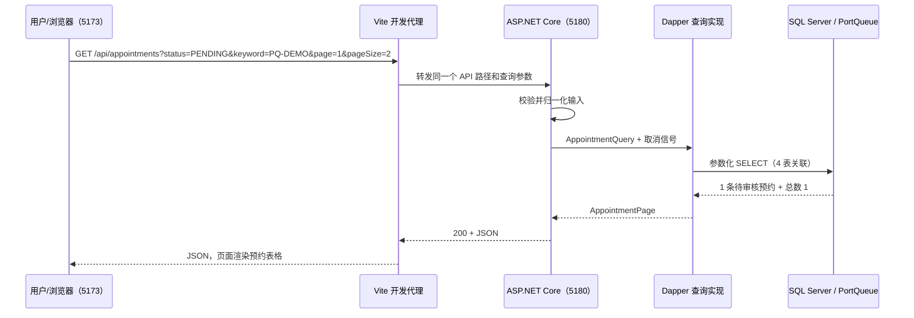

# 阶段 2 交付说明：预约查询的输入、处理与输出

更新日期：2026-11-07。本文用于理解和验收已实现的阶段 2，不代替需求、数据字典和逻辑模型。正式界面截图及浏览器操作验收仍待补齐。

## 1. 这一阶段完成了什么

业务用例：业务人员按预约状态或预约编号、船名、IMO、MMSI 查找预约，查看申请到离港时间和审核结果，按页浏览结果。

| 层次 | 阶段 2 之前 | 本阶段新增或调整 | 当前输出 |
|---|---|---|---|
| 数据库 | 已部署 21 表、3 业务视图、7 过程、8 表级触发器、45 个业务表索引及样例 | 新增 `database/queries/appointments.sql` 参数化 SELECT 文件；没有部署新对象、修改表结构或重新装载开发库数据 | 筛选后总数、当前页预约及关联船舶/审核信息 |
| 后端 | 健康接口、启动配置和连接工厂 | 查询参数校验、应用契约、Dapper 查询实现、预约控制器、统一错误响应、测试 | `GET /api/appointments` 返回 JSON 或明确的错误状态 |
| 前端 | 静态调度总览 | 默认进入真实预约页；筛选、重置、刷新、分页和状态处理；总览保留为“静态”原型入口 | 显示来自 API 的预约表格；失败显示重试提示 |
| 联调 | 前后端分别能启动 | Vite `/api` 代理至后端 5180；后端访问 SQL Server | 同一查询可在 SQL、API 和页面各层对照 |
| 验收文档 | 数据库阶段 1 结果 | 阶段 2 契约、验收矩阵、review、文件说明和启停手册 | 可审查的完成范围与未验证边界 |

样例数据是用 `10_seed_demo.sql` 写入数据库的合成业务事实，并非真实港口或 AIS 数据。它们由 SQL 真正查询，所以区别于写死在 Vue 组件中的 Mock。当前开发库为 5 条 PQ-DEMO 预约：已完成 2 条、已批准 2 条、待审核 1 条。

## 2. 后端：文件职责与输入输出

下面路径均相对仓库根目录。

| 文件/目录 | 输入 | 处理 | 输出 |
|---|---|---|---|
| `src/PortQueue.Api/Appointments/AppointmentQueryRequest.cs` | HTTP 查询字符串 | 页码与页容量范围、状态和关键词长度校验；去首尾空格、状态转大写 | 规范化查询条件，或 400 参数错误 |
| `src/PortQueue.Api/Controllers/AppointmentsController.cs` | 已绑定的请求和取消信号 | 调用预约查询接口 | 200 分页 JSON |
| `src/PortQueue.Application/Appointments/AppointmentQuery.cs` | 校验后的条件 | 定义查询参数契约，不访问数据库 | page、pageSize、status、keyword |
| `src/PortQueue.Application/Appointments/AppointmentPage.cs` | 查询结果 | 定义列表项与分页结构；ID 为字符串，时间带时区 | items、page、pageSize、totalCount |
| `src/PortQueue.Application/Appointments/IAppointmentQueries.cs` | 条件与取消信号 | 规定查询能力，供控制器依赖 | 异步分页结果 |
| `src/PortQueue.Infrastructure/Appointments/SqlAppointmentQueries.cs` | 查询条件 | 打开 SqlClient 连接，用 Dapper 绑定参数、执行 SQL、映射行；处理空页、释放连接 | 应用层分页对象 |
| `database/queries/appointments.sql` | Status、Pattern、Offset、PageSize 参数 | 关联 4 张表，筛选、计数和分页；只读 | 总数与当前页的列集合 |
| `src/PortQueue.Api/Errors/ApiExceptionHandler.cs` | 服务端异常 | 区分数据库暂不可用与其他故障；保留日志追踪标识 | 503 或 500 ProblemDetails，不回传 SQL/堆栈 |
| `src/PortQueue.Api/Program.cs` | 服务配置 | 注册控制器和异常处理；统一参数校验失败格式 | HTTP 请求处理管道 |
| `src/PortQueue.Infrastructure/DependencyInjection.cs` | 应用启动 | 将查询接口绑定到 Dapper 实现 | 可注入的查询服务 |
| `src/PortQueue.Infrastructure/PortQueue.Infrastructure.csproj` | 构建 | 将唯一 SQL 源嵌入程序集 | 运行不依赖当前工作目录寻找 SQL |
| `src/PortQueue.Api/appsettings.Development.json` | 本地启动 | 指定 LocalDB 和连接超时 | 本地数据库连接配置 |
| `src/PortQueue.Api/Appointments.http` | 手工验收请求 | 提供筛选、分页、空结果和非法参数示例 | HTTP 响应；可由支持 .http 的客户端执行，也可复制 URL |

Dapper 的作用是把 SQL 参数送入 SQL Server，并把查询结果映射为 C# 对象。它没有自动生成或修改表结构。当前查询没有调用写业务存储过程；7 个事务过程仍留给对应的写功能。

## 3. 数据库：查询到底读了哪些表

`arrival_appointment` 保存预约事实；经 `port_call` 找到 `ship` 获取船名、IMO、MMSI；通过 `reviewed_by` 左连接 `user_account` 获取审核人的显示名称。未审核预约没有审核人，也必须出现在查询结果中，所以审核人使用 LEFT JOIN。

查询固定按 `requested_arrival_at DESC, appointment_id DESC` 排序。分页偏移量为 `(page - 1) × pageSize`；状态条件与关键词条件取 AND，关键词在四个字段中取 OR。LIKE 特殊字符被转义，参数化用于避免 SQL 注入，转义用于保证按字面搜索，两者职责不同。

总数和当前页由一条 SELECT 得到，配合既有数据库快照读取配置保持同一语句读取一致。无结果返回空 items 和 0；请求超出已有页数时返回空 items，但仍保留筛选后的真实总数。

此 SQL 是运行时查询文件，不是第 4 个数据库 VIEW、不是第 22 张表、也不是需要在对象树中新增的存储过程。不要直接把含参数的文件整段执行并期望它自动创建对象；API 会绑定参数执行它。

测试额外创建的随机测试库包含专用边界记录，用来验证中文、特殊字符、并列时间与大于 2^53 的主键；这些不是开发库新增的预约，测试完成后清理测试库。

## 4. 前端：文件职责与用户操作

| 文件 | 职责 | 输入与输出 |
|---|---|---|
| `src/App.vue` | 工作区与页面入口 | 默认真实预约页，按需加载标记清楚的静态总览 |
| `src/views/AppointmentListView.vue` | 筛选表单、结果表、分页及反馈 | 用户输入关键词/状态/页容量；输出列表、审核信息和状态提示 |
| `src/api/appointments.ts` | HTTP 请求与响应结构校验 | 发送相对路径 `/api/appointments`；检查 ID、时间、状态和分页结构；拒绝错误格式 |
| `src/composables/useAppointments.ts` | 页面查询状态管理 | 管理已提交条件、取消、超时、请求序号与最新结果 |
| `src/types/appointment.ts` | 类型和状态中文名称 | 与后端响应字段对应，避免把编号或状态用错 |
| `src/styles.css` | 工作页样式 | 表格、表单、焦点、状态和窄屏布局 |
| `src/views/OverviewPrototype.vue`、`src/prototype.css` | 原总览迁移和样式隔离 | 静态数据仅供原型参考，不作为真实预约结果 |
| `src/main.ts` | Vue 入口 | 挂载根组件；移除本页未使用的全量 Element Plus 注册与样式 |
| `vite.config.ts` | 本机前端服务与 API 代理 | 5173 开发端口、4173 preview 端口；`/api` 转发至 5180 |

上表前端路径均位于 `web/port-queue-web/` 下。Element Plus、ECharts、Axios 依赖未在本阶段移除；当前查询使用浏览器原生 fetch，不要求为一个列表额外引入组件或图表。

| 用户操作 | 输入 | 当前行为/输出 |
|---|---|---|
| 打开页面 | page=1、pageSize=20 | 自动查询全部预约 |
| 状态筛选 | PENDING、APPROVED 等，空为全部 | 点击“查询”后更新结果并回到第一页 |
| 关键词查询 | 编号、船名、IMO、MMSI | 按字面包含匹配；提交后回到第一页 |
| 更换页容量/翻页 | 2/10/20/50/100，上一页/下一页 | 使用已提交条件，不偷偷采用尚未提交的表单修改 |
| 刷新 | 已提交的条件 | 重新访问 API，读取当前数据库结果 |
| 重置 | 无 | 清空关键词和状态，回到第一页，保留页容量 |
| 查询无匹配 | 不存在的关键词 | 显示“没有符合条件的预约”，可清除筛选 |
| 查询失败 | 网络/API/数据库故障 | 显示错误和重新查询，不使用 Mock 兜底 |

新请求取消旧请求，并使用请求序号避免迟到响应覆盖最新结果。页面固定以 Asia/Shanghai 显示时间；例如数据库 UTC 的 `2026-11-01 00:00:00` 显示为北京时间 `2026-11-01 08:00`，不是数据被修改。

## 5. 一次真实查询的完整链路



前端在浏览器里访问自己的 5173 地址；Vite 在服务端转发至 5180。数据库连接字符串只在后端，浏览器不直接连接 SQL Server。这个代理是开发/preview 配置，今后正式部署仍需配置同源静态站点与 API 转发。

2026-11-07 实测请求：

```http
GET http://127.0.0.1:5173/api/appointments?status=PENDING&keyword=PQ-DEMO&page=1&pageSize=2
```

响应：

```json
{
  "items": [{
    "appointmentId": "14",
    "appointmentNo": "PQ-DEMO-005",
    "shipName": "Demo Vessel 5",
    "imoNo": "PQDEMO5",
    "mmsi": "990010005",
    "requestedArrivalAt": "2026-11-01T00:00:00+00:00",
    "requestedDepartureAt": "2026-11-03T00:00:00+00:00",
    "appointmentStatusCode": "PENDING",
    "reviewerName": null,
    "reviewedAt": null,
    "reviewComment": null
  }],
  "page": 1,
  "pageSize": 2,
  "totalCount": 1
}
```

14 是本机当前生成的内部 ID，重建环境可能不同；演示用业务编号 `PQ-DEMO-005` 对照。HTTP 200+空数组表示成功但没有匹配记录；400 表示条件非法；503 表示数据库暂时无法查询；500 表示其他内部故障，不能混为“没数据”。

## 6. 老师要求的表结构视图、数据视图对应什么

教师通知原文：“主要讲解已经完成的工作，可以把数据库表结构视图和数据视图、已经完成的系统界面等截图展示。”结合上下文，这里的“视图”主要指可供截图展示的结构界面和数据界面，并非限定为 SQL `CREATE VIEW` 对象。

| 展示类别 | 需要证明什么 | 本项目对应内容 |
|---|---|---|
| 表结构展示 | 设计已落实为物理表：字段、类型、主外键、是否允许空、唯一/检查约束 | SQL Server 中的 arrival_appointment、ship、berth_plan、berth_plan_revision 等；对象树、表设计界面、元数据查询结果 |
| 数据展示 | 表内有可查询、可解释的记录，关联数据能对上 | 预约编号、状态、船舶和到访数据；SELECT 结果网格 |
| 数据库业务 VIEW | 多表如何被组织为有业务意义的查询 | v_port_event、v_anchorage_queue、v_current_berth_plan；定义及查询结果 |
| 已完成系统界面 | 用户能通过应用读取数据库信息 | 真实进港预约页面、筛选结果、分页；静态总览不能替代 |

ER 图是概念设计证据，不能完全替代数据库已建成的结构证据；基本表的 SELECT 结果也可作为数据展示，不要求为了截图新增 VIEW。

### 在 VS Code 中准备截图

连接 `(localdb)\PortQueueDev`、选择 `PortQueue`。表结构可展开 Tables 下表的 Columns、Keys、Indexes，或使用扩展提供的设计/脚本查看入口；扩展版本不同菜单名称可能不同。通用方式是在 SQL 编辑器执行下列只读查询，截图结果网格，不需要重跑建表脚本。

```sql
USE [PortQueue];
-- 结构与键/约束：返回多个结果集，可选列定义和约束页截图。
EXEC sys.sp_help N'dbo.arrival_appointment';
EXEC sys.sp_helpconstraint N'dbo.arrival_appointment';

-- 数据：只展示与预约演示有关的列。
SELECT appointment_id, appointment_no, port_call_id,
       requested_arrival_at, requested_departure_at,
       appointment_status_code, reviewed_by, reviewed_at
FROM dbo.arrival_appointment
ORDER BY requested_arrival_at DESC, appointment_id DESC;

-- 结构对应的关联数据：同一预约能查到船名与审核人。
SELECT aa.appointment_no, s.ship_name, aa.appointment_status_code,
       reviewer.display_name AS reviewer_name
FROM dbo.arrival_appointment AS aa
JOIN dbo.port_call AS pc ON pc.port_call_id = aa.port_call_id
JOIN dbo.ship AS s ON s.ship_id = pc.ship_id
LEFT JOIN dbo.user_account AS reviewer ON reviewer.user_id = aa.reviewed_by
ORDER BY aa.requested_arrival_at DESC, aa.appointment_id DESC;

-- 一个已建成的业务 VIEW 查询，可作为额外的数据库成果。
SELECT appointment_no, ship_name, anchorage_name, queue_position,
       queue_status_code, entered_anchorage_at, left_anchorage_at
FROM dbo.v_anchorage_queue
ORDER BY appointment_no;
```

3 个现有业务视图的职责：`v_port_event` 将公共事件和三种分类关联统一为预约事件时间线；`v_anchorage_queue` 组合队列、船舶、锚地及真实进出锚事件时间；`v_current_berth_plan` 选择各计划当前版本并关联泊位、船舶和确认信息。当前版本视图不等于“只显示待执行计划”，已完成计划也可以有当前版本。

中期三分钟内建议准备：一张核心表结构及主外键截图、一张预约/队列数据网格截图、一张真实预约页面截图。完整 21 表清单、ER 图、3 VIEW 定义和规则测试放备用材料，不要求正文逐表朗读。

## 7. 证据与完成边界

2026-11-06：后端 36 项测试通过，包含 22 项真实独立数据库查询用例、12 项 HTTP 契约用例和 2 项健康接口回归；数据库阶段 1 共 59 项通过（其中包含 4 个双连接并发场景，不另外累加）；13 个 SQL 文件静态检查通过；前端类型检查和构建通过。

2026-11-07：普通 Windows PATH 下 pnpm 安装/版本验证通过、锁文件安装检查通过、前端构建通过、原始启动命令成功；5173 的 HTML、Vite Vue 源模块和预约代理请求均返回 200。对象数量重新核对为 21/3/7/8/45，状态数量为 2 已批准、2 已完成、1 待审核。未重跑全部后端/数据库测试，因为本轮没有改业务代码或 SQL。

当前代码实现和 HTTP 联调完成；完整浏览器点击、键盘、窄屏和截图验收待补。前次将阶段 2 直接标为“已完成”不够准确，本轮修正为“实现完成，浏览器验收待补”，不把请求返回 200 等同于最终页面操作已全部验证。

当前未实现：预约登记/撤销/审核写 API 与页面、队列/泊位计划/执行页面、正式账号登录与角色授权、统计页面。已有数据库过程与查询为后续功能提供基础，但不能等同于这些页面已完成。

## 8. 每次交付的固定说明

后续每次变更都说明：本次目标与范围；前端、后端、数据库和配置各自变化；主要文件职责；至少一个输入→处理→输出的例子；实测结果及证据；未验证/未完成事项；提交记录和下一步。本次新增仅为本机前端工具链修复、VS Code 启动任务和文档规则完善，没有新增业务 API、页面或数据库对象。
