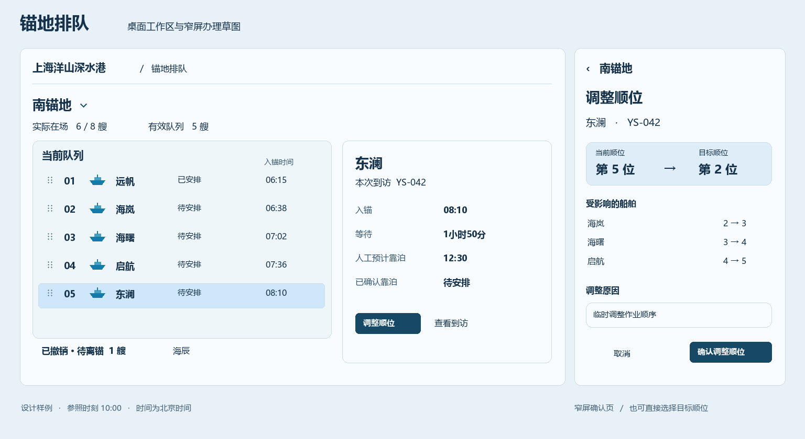

# 4A　锚地排队业务设计

2026-11-27 · 设计交付。调度员选择锚地，看在场船舶和安排顺序，点选一次到访继续办理。记录员从同一页登记实际进出。设计依据为正式功能报告的“锚地排队管理”、[业务视图](../../database/02_views.sql)和[现有事务过程](../../database/04_procedures.sql)。

### 看队列与选到访

草图以10:00为观察时刻。南锚地容量8艘，在场6艘，有效队列5艘，另外一艘预约已撤销、仍在场。选中第五位的东澜，08:10实际入锚，已等1小时50分。调度员可以查看预计靠泊，或进入调整顺位。桌面详情留在队列旁，390px窄屏从队列进入同名详情，返回恢复原位置。窄屏调序确认独占内容区，长名单可滚动，确认按钮始终可达。申请、停留、到访分别用 appointment_id、queue_entry_id、port_call_id 定位，同一船多次到访或同次到访再次入锚均可区分。

| 队列状态 | 页面位置 | 实际在场 | 可办理 |
|---|---|---|---|
| WAITING 待安排 | 有效队列，有顺位 | 入锚至离锚期间计1 | 调序、人工预计、离锚，后续安排泊位 |
| ASSIGNED 已安排 | 有效队列，有顺位 | 同上 | 查已确认安排、调序、离锚 |
| CANCELLED 已撤销 | 在场区单列，顺位为空 | 实际离锚前计1 | 登记离锚 |
| LEFT 已离锚 | 本次到访历史，顺位为空 | 计0 | 查入离锚事实和本段等待 |

**数据来源。** 从本港锚地资料开始关联队列，保留零船锚地。实际在场取有入锚且无离锚事件的停留。有效数取 WAITING、ASSIGNED 并按 queue_position 排列。首次入锚按既有过程结合优先级、实际入锚时刻插入，保留其他成员相对顺序。前端直接使用库内顺位。容量取 anchorage.capacity_vessel_count，空值显示“容量未登记”，0表示零容量。设施受限或停用时仍可查看在场与办理离锚。本段等待按同一次停留的实际离锚时间或查询时刻减入锚时间计算。事件缺失或次序异常时提示核对记录并停用相应写操作。

**预计与计划。** 正式报告要求调度员可单独登记预计靠泊。当前确认计划过程同时更新 estimated_berthing_at，存量值可能来自计划。4B仅将此值标为“既有预计（来源待核）”，详情通过 v_current_berth_plan 另读已确认且适用的版本、泊位和时间。4C拟在队列记录中增一个可空的人工预计字段，旧行初始为空，今后人工提交只写新字段并留审计，确认计划过程停止复制时间。保留旧字段供历史核查，已有视图列保持兼容。迁移前后对比旧值、有效顺位、事件数及当前计划，旧值即使与计划时间相同也不自动认定来源。明确人工输入后优先展示人工预计，原历史值只在详情中按需查看。图中展示的是新录入人工预计后的场景。

### 操作与恢复

| 批次、输入 | 服务端处理 | 输出和后续定位 |
|---|---|---|
| 4B 选择锚地，或从预约携入一次到访 | 只读查询按本港范围返回锚地、容量、在场/有效数和观测时刻。所选锚地返回有效成员及撤销仍在场成员。详情按停留ID独立读取。时间传带时区的值，页面显示北京时间 | 选择更新详情。搜索有可见条件，保留真实顺位。对象不在当前筛选中时可独立查看或主动定位所在锚地。离开和返回保留范围、选择、滚动位置 |
| 4C 选择批准申请、锚地、入锚时间，或选停留记录填离锚时间 | 入离锚调用 usp_record_anchorage_event。离锚须在同一事务内核对用户选择的停留ID仍是未关闭的那次，避免晚到请求关闭下一次停留。操作者来自登录会话 | 返回停留与事件ID，重读队列、到访详情、总览和实际待办。人工预计通过独立受控操作保存，校验停留、业务角色与并发旧值，返回新值和审计依据 |
| 4D 第5位移到第2位，填原因 | 读取同锚地完整有效队列，拖动与“移至第几位”共用确认。显示东澜5→2、海岚2→3、海曙3→4、启航4→5。原位或取消结束预览。确认提交停留ID、新顺位、原因和读取时的队列标识 | 在 usp_adjust_queue 的调度锁内，对锚地及按顺位排列的成员ID、顺位和状态重新计算并比对快照。匹配时一次事务更新四条调整记录及审计。冲突时返回最新队列，保留原因供用户重新选择 |

搜索或分页后调序先展开完整有效队列。抓取期间保持对象稳定，放下时显示新旧顺位，Esc取消并返回焦点。鼠标、触摸把手、键盘按钮均可选择目标。切换账号或离开后清空未提交预览。5A开放后，所选到访可进入泊位排期并查看全港资源，返回恢复原队列。

| 角色 | 查看 | 登记入离锚 | 人工预计、调序 |
|---|---|---|---|
| 调度员、管理员 | 队列与详情 | 可办理 | 可办理 |
| 记录员 | 实际在场及待记录事项优先 | 可办理 | 只读 |
| 审核员 | 查询及到访追溯 | 只读 | 只读 |

沿用已开放的匿名概要范围，新增队列办理页及专用明细查询设计为登录后访问。HTTP服务依会话授权，写入过程检查具体角色。现有锚地过程仅检查账号与角色启用，4C/4D补齐。4B用 portqueue_probe 复核三视图与所需设施列，容量、锚地状态等列按查询最小授予。

输入缺失时在字段旁保留填写内容。会话过期重新登录，权限不足收起写入口。容量刚满、已离锚、顺位过期等业务冲突读回最新事实。服务故障清除失效结果并可重试读取。若写请求超时，先按停留ID、事件或调整明细核对操作者、时刻与前后值，结果仍不确定时保留“待核对”。单凭当前顺位无法证明本次保存成功。

### 设计走查与分批验收

| 用例 | 初始条件与动作 | 可观察结果 | 验收批次 |
|---|---|---|---|
| Q1 | 空锚地、单船、容量未知、0容量 | 0与未知分别呈现，单船无需调序，零容量拒绝入锚 | 4B/4C |
| Q2 | 同船两次到访，一次到访有两段停留，点搜索结果并返回 | 选中正确停留，历史分段等待正确，原清单仍可浏览 | 4B |
| Q3 | 草图的5条有效记录与1条撤销在场记录 | 在场6、有效5。撤销船离锚后在场5、有效5 | 4B/4C |
| Q4 | 满容量、未批准、重复入锚，或离锚早于入锚、停留ID过时 | 拒绝对应写入，队列、事件、分类关联及审计均无部分写入 | 4C |
| Q5 | 人工预计12:30，随后确认13:00靠泊 | 两个时间及来源分别可读。计划修订后人工值保留，历史来源待核值可回查 | 4C及计划回归 |
| Q6 | 在完整队列执行5→2，分别测试确认、原位和取消 | 确认仅影响第2—5位，原因和四条前后值可核对。原位、取消无写入 | 4D |
| Q7 | 两浏览器同时读队列，甲先调序或有船离锚，乙再确认 | 乙看到过期提示和新队列，甲的顺序保留，乙的原因可复用 | 4D |
| Q8 | 记录员键盘登记离锚，审核员尝试写入，调度员窄屏调序，模拟读失败和保存响应丢失 | UI、HTTP和过程均按角色限制。按钮与拖动等价，失败可恢复，未知结果先核对 | 4B—4D |

本次设计走查核对了正式报告、视图的事件来源、计划确认写入、权限脚本和现有调序事务。按图推演5→2后顺序为远帆、东澜、海岚、海曙、启航，在场仍为6。真实SQL、HTTP、浏览器和视觉测试随各实现批次执行。
